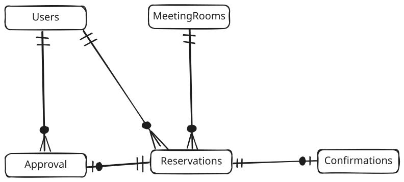
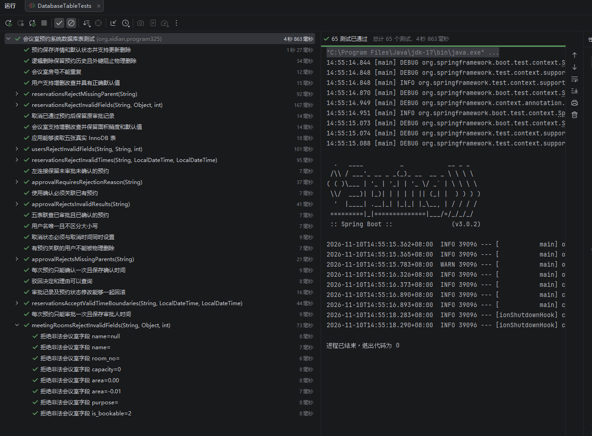

# 会议室预约系统数据库表设计

设计人：张茂林

对应报告章节：3.4 数据库设计

本设计将 ER 图中的 Users、MeetingRooms、Reservations、Approval、Confirmations 五个实体转换为关系表，支持用户登录、会议室查询和维护、提交与取消预约、审批及历史记录查询。Confirmations 对应可选的使用确认功能。配套建表文件为 `src/main/resources/db/schema.sql`。

## 一 设计约定

采用 MySQL 8.0.16 及以上版本、InnoDB 引擎和 utf8mb4 字符集，与项目现有 MySQL Connector/J、MyBatis 技术依赖相配套。主键统一使用 BIGINT UNSIGNED 自增，外键与被引用主键类型一致；面积保留两位小数。时间统一按北京时间 Asia/Shanghai 写入 DATETIME，由应用统一处理时区。数据库名由部署时指定。

保留 ER 图中的表名及大小写。用户名、房号使用 `utf8mb4_0900_ai_ci` 排序规则，按不区分大小写和重音的规则判断唯一；状态和角色使用 `ascii_bin`，只接受约定的大写代码。业务层应先去除账号、房号、主题等文本首尾空白。密码只保存带算法标识及盐的密码散列，禁止保存明文。

时间区间采用左闭右开形式 `[start_time, end_time)`。以一小时为单位，同一预约的所有使用小时须属于同一天，至少预约一小时。例如 09:00 至 11:00 占用 09:00、10:00 两个小时，允许下一场 11:00 开始；当天最后一段允许 23:00 至次日 00:00，00:00 只是结束边界。跨日使用须拆成多条预约。

在报告既有五表结构上，补充会议室逻辑删除时间、可预约标记和预约取消时间。暂不增加照片、二维码、审批历史、多角色权限等额外实体。审批按照报告初稿采用“一次预约最多一条最终审批记录”；驳回后如需重新申请，应新建预约。

## 二 实体关系及关系模式



| 主表 | 从表及关联字段 | 关系 | 含义 |
| --- | --- | --- | --- |
| Users | Reservations.user_id | 1 对 0..N | 每次预约必须属于一个用户，用户可以没有预约 |
| MeetingRooms | Reservations.room_id | 1 对 0..N | 每次预约必须对应一个会议室 |
| Users | Approval.approver_id | 1 对 0..N | 每次审批对应一个管理员，管理员可以处理多次审批 |
| Reservations | Approval.reservation_id | 1 对 0..1 | 未审批时没有审批记录，最终审批至多一条 |
| Reservations | Confirmations.reservation_id | 1 对 0..1 | 未确认时没有记录，使用确认至多一条 |

关系模式如下，PK 表示主键，FK 表示外键，UK 表示唯一键：

- Users(**user_id PK**, username UK, password_hash, role, created_at)
- MeetingRooms(**room_id PK**, name, room_no UK, capacity, area, purpose, is_bookable, deleted_at, created_at, updated_at)
- Reservations(**reservation_id PK**, user_id FK, room_id FK, subject, attendees, start_time, end_time, status, created_at, cancelled_at)
- Approval(**approval_id PK**, reservation_id FK UK, approver_id FK, result, reason, approved_at)
- Confirmations(**confirmation_id PK**, reservation_id FK UK, confirmed_at)

## 三 表结构与字段字典

以下“无”表示没有显式默认值，插入时必须提供；“自增”表示数据库生成。所有非主键字段的可空性均在表中列明。

### 1 Users 用户表

| 字段名 | 字段类型 | 可为空 | 默认值 | 字段含义及约束 |
| --- | --- | --- | --- | --- |
| user_id | BIGINT UNSIGNED | 否 | 自增 | 用户编号，PK |
| username | VARCHAR(50) | 否 | 无 | 登录账号，UK，去空格后不得为空 |
| password_hash | VARCHAR(255) | 否 | 无 | 带算法标识及盐的密码散列，不得为空 |
| role | VARCHAR(10) | 否 | USER | USER 预约用户；ADMIN 管理员 |
| created_at | DATETIME | 否 | CURRENT_TIMESTAMP | 用户创建时间 |

管理员也是用户，可提交本人预约。无需另建管理员表；审批时由后端检查其 ADMIN 身份。

### 2 MeetingRooms 会议室表

| 字段名 | 字段类型 | 可为空 | 默认值 | 字段含义及约束 |
| --- | --- | --- | --- | --- |
| room_id | BIGINT UNSIGNED | 否 | 自增 | 会议室编号，PK |
| name | VARCHAR(100) | 否 | 无 | 会议室名称，去空格后不得为空 |
| room_no | VARCHAR(30) | 否 | 无 | 房号，UK，去空格后不得为空 |
| capacity | INT UNSIGNED | 否 | 无 | 最大容纳人数，大于 0 |
| area | DECIMAL(8,2) | 否 | 无 | 面积，单位平方米，大于 0 |
| purpose | VARCHAR(255) | 否 | 无 | 用途说明，去空格后不得为空 |
| is_bookable | TINYINT UNSIGNED | 否 | 1 | 1 可预约；0 暂停预约，可选状态管理 |
| deleted_at | DATETIME | 是 | NULL | 逻辑删除时间，NULL 表示未删除 |
| created_at | DATETIME | 否 | CURRENT_TIMESTAMP | 创建时间 |
| updated_at | DATETIME | 否 | CURRENT_TIMESTAMP | 更新时自动刷新 |

删除会议室时更新 deleted_at，不物理删除。历史预约仍可通过外键查询该会议室；房号仍保持唯一，恢复会议室应恢复原记录。存在未结束的待审批或已通过预约时拒绝删除，须先按预约规则处理。管理员修改容量时，也应检查未结束的有效预约，避免新容量小于已预约人数。历史记录显示会议室当前基本信息；若以后要求保留修改前名称等完整快照，应单独设计版本或审计机制。

### 3 Reservations 预约表

| 字段名 | 字段类型 | 可为空 | 默认值 | 字段含义及约束 |
| --- | --- | --- | --- | --- |
| reservation_id | BIGINT UNSIGNED | 否 | 自增 | 预约编号，PK |
| user_id | BIGINT UNSIGNED | 否 | 无 | 申请人，FK → Users.user_id |
| room_id | BIGINT UNSIGNED | 否 | 无 | 会议室，FK → MeetingRooms.room_id |
| subject | VARCHAR(200) | 否 | 无 | 会议主题，去空格后不得为空 |
| attendees | INT UNSIGNED | 否 | 无 | 参会人数，大于 0；业务层校验不超过容量 |
| start_time | DATETIME | 否 | 无 | 开始时间，分和秒为 0 |
| end_time | DATETIME | 否 | 无 | 结束时间，分和秒为 0，晚于开始时间 |
| status | VARCHAR(10) | 否 | PENDING | PENDING、APPROVED、REJECTED、CANCELLED |
| created_at | DATETIME | 否 | CURRENT_TIMESTAMP | 提交时间 |
| cancelled_at | DATETIME | 是 | NULL | 仅 CANCELLED 状态必须非空，其余状态必须为空 |

状态说明：PENDING 待审批，APPROVED 已通过，REJECTED 已驳回，CANCELLED 已取消。开始、结束时间组合须满足本设计的同一天整点连续小时规则。未使用、已使用不再作为预约审批状态重复保存，而通过 Confirmations 的存在性区分；没有确认记录只能表示“未确认使用”，不能据此断言未实际使用。

### 4 Approval 审批表

| 字段名 | 字段类型 | 可为空 | 默认值 | 字段含义及约束 |
| --- | --- | --- | --- | --- |
| approval_id | BIGINT UNSIGNED | 否 | 自增 | 审批编号，PK |
| reservation_id | BIGINT UNSIGNED | 否 | 无 | FK → Reservations.reservation_id，UK |
| approver_id | BIGINT UNSIGNED | 否 | 无 | FK → Users.user_id，必须由 ADMIN 审批 |
| result | VARCHAR(10) | 否 | 无 | APPROVED 通过；REJECTED 驳回 |
| reason | VARCHAR(500) | 是 | NULL | 通过时选填；驳回时必须填写非空理由 |
| approved_at | DATETIME | 否 | CURRENT_TIMESTAMP | 实际审批时间 |

reservation_id 唯一且非空，使预约与审批形成 1 对 0..1。待审批预约不预先插入审批行。已通过预约被取消后保留原审批记录，Approval.result 表示曾经作出的决定，Reservations.status 表示当前预约状态。

### 5 Confirmations 使用确认表

| 字段名 | 字段类型 | 可为空 | 默认值 | 字段含义及约束 |
| --- | --- | --- | --- | --- |
| confirmation_id | BIGINT UNSIGNED | 否 | 自增 | 使用确认编号，PK |
| reservation_id | BIGINT UNSIGNED | 否 | 无 | FK → Reservations.reservation_id，UK |
| confirmed_at | DATETIME | 否 | CURRENT_TIMESTAMP | 实际确认时间 |

此表属于可选功能。后端须校验操作者为预约本人、预约已通过且未取消，并按产品约定的会议前后时间窗口允许确认。题目未规定具体窗口长度，建表不固化分钟数。重复确认由唯一键拒绝。确认后不允许再取消；未启用该功能时保持此表为空，不自动标记“已使用”。

## 四 主键 外键与索引

所有表使用单列代理主键，避免用户名、房号变动影响关联。所有外键均为 `ON DELETE RESTRICT ON UPDATE RESTRICT`，禁止删除仍被引用的父记录，不级联删除预约、审批和确认记录。

| 索引名 | 所属表及字段 | 作用 |
| --- | --- | --- |
| uk_users_username | Users(username) | 防止重复账号，支持登录查询 |
| uk_rooms_room_no | MeetingRooms(room_no) | 防止重复房号 |
| idx_rooms_filter | MeetingRooms(deleted_at, is_bookable, capacity) | 筛选未删除、可预约且容量合适的会议室 |
| idx_reservations_user_created | Reservations(user_id, created_at) | 按用户查询预约历史及时间排序 |
| idx_reservations_room_status_time | Reservations(room_id, status, start_time, end_time) | 查询同一会议室有效预约和时间冲突 |
| idx_reservations_status_created | Reservations(status, created_at) | 查询待审批队列及按提交时间排序 |
| uk_approval_reservation | Approval(reservation_id) | 限制同一预约只审批一次，支持详情联查 |
| idx_approval_approver_time | Approval(approver_id, approved_at) | 查询管理员审批记录 |
| uk_confirmations_reservation | Confirmations(reservation_id) | 限制同一预约只确认一次，支持使用情况联查 |

上述索引不保证所有查询免排序；冲突索引的 end_time 条件仍可能作为过滤条件。应在真实数据量下用 EXPLAIN 评估，再决定是否增加索引。

## 五 业务完整性与事务规则

### 1 数据库约束与业务校验的边界

数据库负责主键、外键、唯一键、非空、合法状态、正数、整点、连续区间、取消时间配对以及驳回理由约束。跨表及跨行规则由后端在事务中实现：参会人数不超过容量、审批人是管理员、有效时间不冲突、会议室未删除且可预约、审批与预约状态同步、确认者和确认时间合法、取消权限与状态迁移合法。

建表脚本本身不会自动完成这些业务规则。直接执行 INSERT 或 UPDATE 可以绕过尚未实现的服务层；应用应统一通过业务服务写入，而不把表约束当作完整预约服务。

### 2 预约占用及并发控制

采用“待审批即暂占”的规则：PENDING、APPROVED 均参与冲突判断；REJECTED、CANCELLED 释放时段。该规则用于落实报告的提交时冲突检查，也防止同一时段积累大量重复申请。若以后改成多申请竞争审批，应同时调整筛选、提交与审批逻辑。

两个区间重叠的条件为：`已有开始时间 < 新结束时间 AND 已有结束时间 > 新开始时间`。不能用“开始时间相同”判断冲突，也不能用包含端点的 BETWEEN 判断相邻会议。

查询空闲会议室的 SQL 模板如下，`:参数` 为说明性占位符，MyBatis 中应转换为 `#{参数}`：

```sql
SELECT m.room_id, m.name, m.room_no, m.capacity, m.area, m.purpose
FROM MeetingRooms m
WHERE m.deleted_at IS NULL
  AND m.is_bookable = 1
  AND m.capacity >= :attendees
  AND NOT EXISTS (
      SELECT 1 FROM Reservations r
      WHERE r.room_id = m.room_id
        AND r.status IN ('PENDING', 'APPROVED')
        AND r.start_time < :end_time
        AND r.end_time > :start_time
  );
```

列表筛选只是查询提示，提交时必须再次检查。所有同一会议室的预约写操作统一按“会议室行 → 预约行”顺序加锁：

1. 开始事务，通过 `SELECT ... FROM MeetingRooms WHERE room_id = :room_id FOR UPDATE` 锁定会议室，校验存在、未删除、可预约和容量。
2. 用上面的重叠条件执行 `SELECT reservation_id FROM Reservations ... FOR UPDATE`，读取最新有效预约。审批时排除当前 reservation_id。使用锁定读，避免事务中先前快照漏掉刚提交的记录。
3. 无冲突且开始时间晚于当前时间时插入 PENDING 预约，然后提交；失败则回滚。

所有申请入口均锁同一会议室父行，因此即使当前没有任何预约，也能串行化同室的并发提交。重复点击同一用户、同一房间、同一时段的有效预约会被重叠检查拒绝；若要求网络重试返回原成功结果，应在接口层另行实现幂等键。取消或驳回后重新提交属于新申请。

### 3 审批与取消

审批按同一锁顺序开启事务，锁定预约后确认其仍为 PENDING；通过前再次检查房间、容量、时间和冲突；驳回必须提供理由。插入 Approval，同时将 Reservations.status 更新为相应结果；任一步失败全部回滚。更新可附加 `WHERE status = 'PENDING'` 并校验影响行数为 1，唯一键作为防止重复审批的第二层约束。

合法迁移为 `PENDING → APPROVED / REJECTED / CANCELLED`，以及 `APPROVED → CANCELLED`。REJECTED、CANCELLED 为终止状态，不再次审批。按本设计，只有预约本人可取消本人未结束、尚未确认使用的有效预约，管理员的预约用户能力不自动授予取消他人预约的权限。取消在事务内锁定并重新检查状态、结束时间和确认记录，设置 CANCELLED 与 cancelled_at，保留已有审批记录，无需新增审批。

修改会议室容量、删除会议室、确认使用和取消也必须遵循相同锁顺序，并在锁内检查未结束的有效预约或目标预约状态，避免与提交、审批并发时产生不一致。

### 4 记录查询

个人预约列表以当前登录会话中的 user_id 为条件，禁止信任前端任意传入的用户编号。审批人、时间、结果、理由通过 LEFT JOIN Approval 查询；使用情况通过 LEFT JOIN Confirmations 查询。未审批、未确认时保留预约行并返回相应空值。查询全部预约前由后端校验 ADMIN 权限。

## 六 第三范式说明

第一范式：字段均存储单一原子值，连续整点时段以起止时间表示，不在一个字段中保存多个不连续时间段或用户列表。

第二范式：各表均以单列主键标识一条记录，非主属性完全依赖主键，不存在对复合主键某部分的依赖。

第三范式：用户账号及角色仅保存在 Users；会议室容量、面积、用途仅保存在 MeetingRooms；预约仅通过外键关联用户和会议室；审批仅通过 approver_id 关联审批人，不重复保存审批人的账号和角色；确认人可由预约所属用户推出，因此 Confirmations 不重复保存 user_id。非主属性不通过其他非主属性间接决定。

Approval.reservation_id 和 Confirmations.reservation_id 同时是候选键。Approval.result 记录审批事件结果，Reservations.status 记录当前生命周期状态，取消后仍保留原审批结果；两者不能简单视作同一含义字段，审批时须用事务保持合法一致性。

## 七 执行与验收

在 MySQL 客户端新建并选择一个空数据库后执行建表脚本，例如：

```sql
CREATE DATABASE meeting_room_reservation
  CHARACTER SET utf8mb4 COLLATE utf8mb4_0900_ai_ci;
USE meeting_room_reservation;
SOURCE E:/CS/school/Program325/src/main/resources/db/schema.sql;
SHOW TABLES;
```

脚本不包含 DROP TABLE，不覆盖已有数据，也没有使用 IF NOT EXISTS 掩盖已有表结构不一致。它作为手动建表资源保存，不配置 Spring Boot 启动时自动初始化。应用通过 `application.properties` 中的数据源配置连接数据库。运行前在 IDEA 运行配置或环境变量中设置 `DB_PASSWORD`；地址和账号也可分别由 `DB_URL`、`DB_USERNAME` 指定。业务服务由后端模块继续实现。

| 验收点 | 预期 |
| --- | --- |
| 重复账号、重复房号 | 唯一键拒绝 |
| 不存在的申请人、会议室、审批人或预约 | 外键拒绝 |
| 非法角色或状态、空主题、人数为 0、面积非正数 | CHECK 拒绝 |
| 结束早于开始、非整点、跨日实际使用 | CHECK 拒绝 |
| 23:00 至次日 00:00 | 作为当天最后一小时允许 |
| 驳回理由为 NULL、空串或仅普通空格 | CHECK 拒绝 |
| 同预约重复审批或重复确认 | 唯一键拒绝 |
| 取消状态与取消时间不配对 | CHECK 拒绝 |
| 删除被预约引用的会议室 | 外键拒绝物理删除，业务使用逻辑删除 |
| 并发提交、越权审批、超容量、非法确认及状态迁移 | 后端按本章事务和权限规则实现后联调验证 |

2026 年 11 月 10 日，已在 MySQL 8.0.46 中执行建表脚本，建立五张表及五个外键，并使用 `DatabaseTableTests` 完成 65 项真实数据库集成测试，全部通过。加上原有启动测试，完整测试共 66 项通过。测试覆盖合法读写、默认值、唯一键、外键、非空及 CHECK 边界、重复审批与确认、历史关联查询和跨表事务回滚。每个测试均在事务结束时自动回滚，测试前后五张表记录数一致。上述结果验证数据库层的行为；后端权限、容量跨表校验和并发业务流程尚须在服务实现后联调测试。

测试代码：`src/test/java/org/xidian/program325/DatabaseTableTests.java`。先初始化数据库并设置 `DB_PASSWORD`，然后在 JDK 17 环境中执行 `mvn test`，或在 IDEA 中直接运行测试类。



技术依据：[MySQL CHECK 约束](https://dev.mysql.com/doc/refman/8.0/en/create-table-check-constraints.html)、[InnoDB 锁定读](https://dev.mysql.com/doc/refman/8.0/en/innodb-locking-reads.html)。
