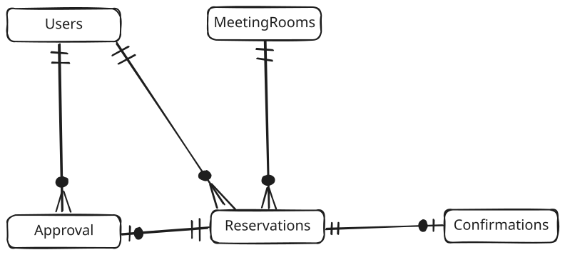

# 会议室预约系统数据库表设计

设计人：张茂林

本设计依据[实训题目](../need/实训题目.docx)中的会议室预约系统需求。用户、会议室、预约和审批四张表支撑必做功能，使用确认表支撑可选功能。管理员使用同一用户表，可以提交自己的预约，也可以审批和查询全部预约。

## 一 实体关系

| 主表 | 从表关联字段 | 基数 | 业务含义 |
| --- | --- | --- | --- |
| Users | Reservations.user_id | 1 对 0..N | 每条预约有一名申请人，一名用户可以提交多条预约 |
| MeetingRooms | Reservations.room_id | 1 对 0..N | 每条预约对应一间会议室，一间会议室可以有多条预约 |
| Users | Approval.approver_id | 1 对 0..N | 每条审批有一名审批人，审批人须有管理员角色 |
| Reservations | Approval.reservation_id | 1 对 0..1 | 一条预约最多有一条最终审批记录 |
| Reservations | Confirmations.reservation_id | 1 对 0..1 | 一条预约最多有一条使用确认记录 |

## 二 表结构

字段类型按 MySQL 设计。PK 表示主键，FK 表示外键，UK 表示唯一键。主键采用自增的 `BIGINT UNSIGNED`，外键与对应主键同类型。时间统一按北京时间保存，数据库会话与应用采用相同的时区。表内「无」表示没有默认值。

### 1 Users 用户表

| 字段 | 类型 | 可空 | 默认值 | 说明及约束 |
| --- | --- | --- | --- | --- |
| `user_id` | BIGINT UNSIGNED | 否 | 自增 | PK，用户编号 |
| `username` | VARCHAR(50) | 否 | 无 | UK，登录账号，去掉首尾空白后须非空 |
| `password_hash` | VARCHAR(255) | 否 | 无 | 带算法标识及盐的密码散列，须非空 |
| `role` | VARCHAR(10) | 否 | `USER` | 角色，限 `USER` 或 `ADMIN` |
| `created_at` | DATETIME | 否 | 当前时间 | 账号创建时间 |

账号按不区分大小写和重音的规则判重。两种登录页面共用账号数据，审批权限由后端根据角色判定。

### 2 MeetingRooms 会议室表

| 字段 | 类型 | 可空 | 默认值 | 说明及约束 |
| --- | --- | --- | --- | --- |
| `room_id` | BIGINT UNSIGNED | 否 | 自增 | PK，会议室编号 |
| `name` | VARCHAR(100) | 否 | 无 | 会议室名称，去掉首尾空白后须非空 |
| `room_no` | VARCHAR(30) | 否 | 无 | UK，房号，去掉首尾空白后须非空 |
| `capacity` | INT UNSIGNED | 否 | 无 | 最大容纳人数，大于 0 |
| `area` | DECIMAL(8,2) | 否 | 无 | 面积，单位为平方米，大于 0 |
| `purpose` | VARCHAR(255) | 否 | 无 | 用途，去掉首尾空白后须非空 |
| `is_bookable` | TINYINT UNSIGNED | 否 | `1` | `1` 可预约，`0` 暂停预约 |
| `deleted_at` | DATETIME | 是 | NULL | 逻辑删除时间，空值表示未删除 |
| `created_at` | DATETIME | 否 | 当前时间 | 会议室记录创建时间 |
| `updated_at` | DATETIME | 否 | 当前时间 | 最近修改时间，修改会议室时更新 |

房号按不区分大小写和重音的规则判重，逻辑删除后继续保留原房号。删除会议室前须处理尚未结束的有效预约。历史预约通过 `room_id` 查询会议室当前的基本资料。

### 3 Reservations 预约表

| 字段 | 类型 | 可空 | 默认值 | 说明及约束 |
| --- | --- | --- | --- | --- |
| `reservation_id` | BIGINT UNSIGNED | 否 | 自增 | PK，预约编号 |
| `user_id` | BIGINT UNSIGNED | 否 | 无 | FK，申请人，引用 `Users.user_id` |
| `room_id` | BIGINT UNSIGNED | 否 | 无 | FK，引用 `MeetingRooms.room_id` |
| `subject` | VARCHAR(200) | 否 | 无 | 会议主题，去掉首尾空白后须非空 |
| `attendees` | INT UNSIGNED | 否 | 无 | 参会人数，大于 0，且提交时不得超过会议室容量 |
| `start_time` | DATETIME | 否 | 无 | 会议开始时间，须为整点，且提交时须晚于当前时间 |
| `end_time` | DATETIME | 否 | 无 | 会议结束时间，须为整点，且晚于开始时间 |
| `status` | VARCHAR(10) | 否 | `PENDING` | 存储状态，限 `PENDING`、`APPROVED`、`REJECTED`、`CANCELLED` |
| `created_at` | DATETIME | 否 | 当前时间 | 预约提交时间 |
| `cancelled_at` | DATETIME | 是 | NULL | 仅在状态为 `CANCELLED` 时填写，须不早于提交时间 |

预约区间包含开始时刻，结束时刻可供下一场预约使用。一次预约至少一小时，只允许预约同一天内连续的小时。当天最后一个时段可以在次日 00:00 结束，例如 23:00 至次日 00:00。不连续或实际跨日的时段分开提交。

| 存储状态及时间条件 | 对外状态 | 占用规则 |
| --- | --- | --- |
| `PENDING`，当前时间早于开始时间 | 待审批 | 暂占预约区间 |
| `PENDING`，当前时间达到或晚于开始时间 | 已过期 | 立即释放时段，审批队列不再列出，历史记录保留 |
| `APPROVED` | 已通过 | 预约区间计为已占用，结束后的记录可用于历史查询 |
| `REJECTED` | 已驳回 | 释放时段 |
| `CANCELLED` | 已取消 | 释放时段，保留已有审批记录 |

「已过期」由存储状态、开始时间和本次操作的业务时点计算。空闲筛选、提交校验、审批队列和历史查询采用相同规则。

### 4 Approval 审批表

| 字段 | 类型 | 可空 | 默认值 | 说明及约束 |
| --- | --- | --- | --- | --- |
| `approval_id` | BIGINT UNSIGNED | 否 | 自增 | PK，审批编号 |
| `reservation_id` | BIGINT UNSIGNED | 否 | 无 | FK、UK，引用 `Reservations.reservation_id`，保证每条预约最多审批一次 |
| `approver_id` | BIGINT UNSIGNED | 否 | 无 | FK，引用 `Users.user_id`，审批时校验管理员身份 |
| `result` | VARCHAR(10) | 否 | 无 | 审批结果，限 `APPROVED` 或 `REJECTED` |
| `reason` | VARCHAR(500) | 是 | NULL | 审批说明，驳回时必填，去掉首尾空白后须非空 |
| `approved_at` | DATETIME | 否 | 当前时间 | 审批处理时间，通过和驳回均记录 |

审批记录保存当时作出的决定。预约后来取消时，预约表记录当前状态，审批表保留原结果、处理时间和理由。驳回后重新预约须提交新记录。

### 5 Confirmations 使用确认表

| 字段 | 类型 | 可空 | 默认值 | 说明及约束 |
| --- | --- | --- | --- | --- |
| `confirmation_id` | BIGINT UNSIGNED | 否 | 自增 | PK，使用确认编号 |
| `reservation_id` | BIGINT UNSIGNED | 否 | 无 | FK、UK，引用 `Reservations.reservation_id`，保证每条预约最多确认一次 |
| `confirmed_at` | DATETIME | 否 | 当前时间 | 用户确认使用的时间 |

启用可选的使用确认功能后，预约本人可以在系统约定的时间窗口内确认已通过的预约。确认人可通过预约获取。存在确认记录时显示「已确认使用」，没有确认记录时显示「未确认使用」。周占用表可按预约起止时间和有效状态生成。

## 三 键和索引

五条外键均限制对被引用记录的物理删除和主键修改，保留预约历史。账号、房号、审批关联的预约编号和确认关联的预约编号均建立唯一索引。

| 表 | 普通索引字段，按顺序排列 | 用途 |
| --- | --- | --- |
| MeetingRooms | `deleted_at`、`is_bookable`、`capacity` | 过滤已删除、暂停预约和容量不足的会议室 |
| Reservations | `user_id`、`created_at` | 查询个人预约历史 |
| Reservations | `room_id`、`status`、`start_time`、`end_time` | 查询同一会议室的有效预约和重叠时段 |
| Reservations | `status`、`created_at` | 查询待审批队列并按提交时间排序 |
| Approval | `approver_id`、`approved_at` | 查询管理员的审批记录 |

## 四 跨表业务约束

| 场景 | 完整性规则 |
| --- | --- |
| 提交预约 | 校验会议室未删除且可预约、人数在容量内、开始时间在未来。已有有效预约在新预约结束前开始，且在新预约开始后结束，两个时段才算重叠。 |
| 并发占用 | 同一会议室的预约写入在事务内先锁会议室、再检查相关预约。提交时重新校验容量和重叠时段。 |
| 审批 | 仅管理员可处理仍未过期的待审批记录。通过前复核会议室、容量和重叠时段。审批记录与预约状态在同一事务内更新。 |
| 取消 | 预约本人可取消尚未过期的待审批预约，或尚未结束且未确认使用的已通过预约。取消无需审批，同步记录取消时间并释放时段。 |
| 维护会议室 | 有尚未结束的有效预约时限制删除。修改容量时检查这些预约的参会人数。暂停预约时停止接受新申请，已通过的预约继续有效。 |
| 查询历史 | 个人列表按当前登录用户过滤。管理员可查看全部预约和对应的审批信息。确认和审批记录缺失时，预约本身仍保留在列表中。 |

## 五 第三范式

用户信息集中在用户表，会议室资料集中在会议室表，预约只保存申请人和会议室的外键。审批与使用确认各自保存对应事件的字段，以唯一的预约外键约束每次预约的事件数量。「已过期」由时间推导，使用确认状态由确认记录推导，避免为同一事实重复保存状态。
